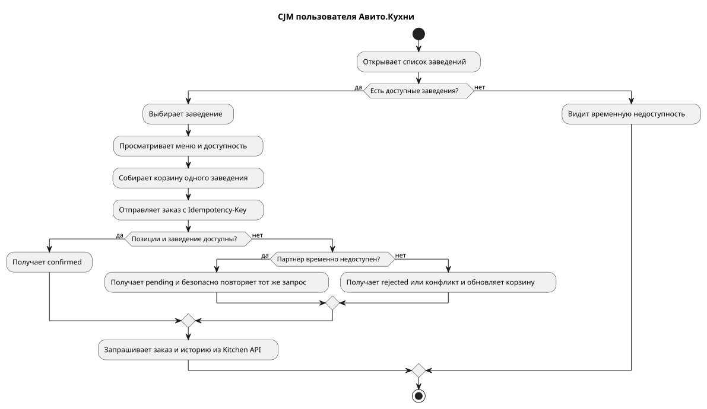
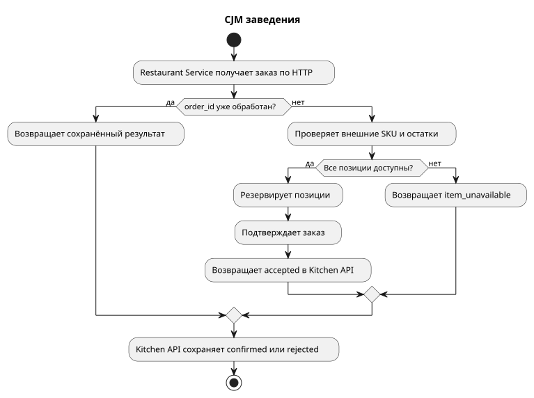
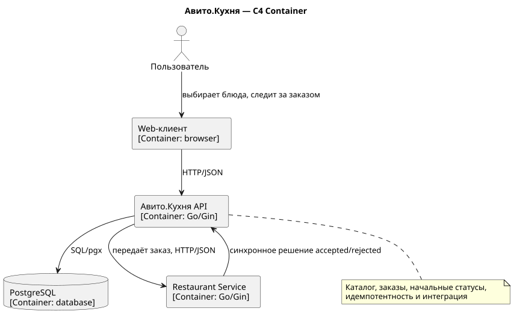
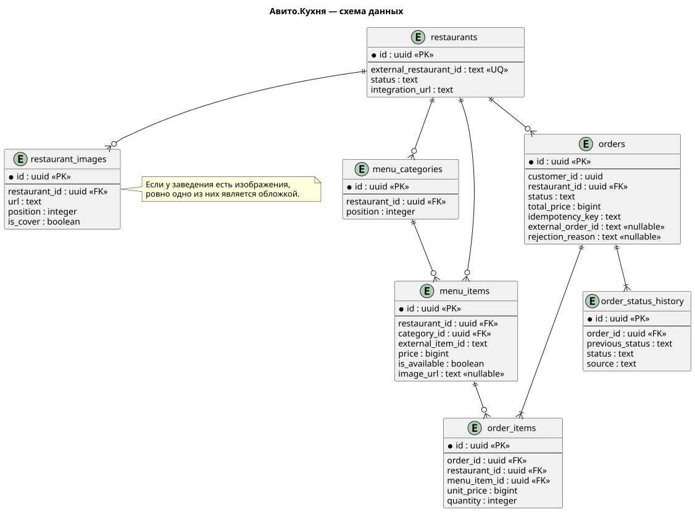

# Авито.Кухня

MVP backend-сервиса для интеграции web-клиента Авито.Кухни с заведениями, принимающими заказы. Kitchen API предоставляет каталог и пользовательские операции с заказами, сохраняет их состояние в PostgreSQL и передаёт новые заказы отдельному демонстрационному Restaurant Service.

Клиент взаимодействует **только с Kitchen API**. Restaurant Service — внутренний сервис-партнёр внутри Docker network; его адрес и API не раскрываются клиентскому приложению. Исходные требования находятся в [`backend-trainee-assignment-autumn-2026.md`](backend-trainee-assignment-autumn-2026.md).

## Возможности

Для пользователя:

- просмотр списка и карточки заведений;
- просмотр галереи заведения, меню, доступности и изображений блюд;
- идемпотентное создание заказа из позиций одного заведения;
- получение заказа с зафиксированными ценами и историей статусов;
- получение списка заказов по `customer_id` от новых к старым.

Для заведения:

- отдельный internal HTTP API для информации о заведении и приёма заказов;
- проверка внешних SKU и остатка;
- принятие заказа либо отказ с причиной `item_unavailable`;
- защита от повторного списания остатка при повторной доставке одного `order_id`.

## Пользовательские сценарии

Основной путь пользователя: список заведений → карточка → меню → локальная корзина → `POST /api/v1/orders` → результат → чтение заказа и истории из Kitchen API.



Restaurant Service получает внутренний заказ от Kitchen, дедуплицирует его, проверяет позиции и синхронно возвращает принятое решение. Дальнейшие статусы приготовления в текущем MVP не реализованы.



Исходники диаграмм: [`cjm-user.puml`](docs/diagrams/cjm-user.puml) и [`cjm-restaurant.puml`](docs/diagrams/cjm-restaurant.puml).

## Архитектура

```text
Web Client ──HTTP/JSON──> Kitchen API ──SQL──> PostgreSQL
                              │
                              └──internal HTTP/JSON──> Restaurant Service
```



- **Kitchen API** — единственная публичная точка входа, каталог, валидация, order orchestration и пользовательское состояние заказов.
- **PostgreSQL** — долговременный source of truth, снимки заказа, история статусов, ограничения целостности и клиентская идемпотентность.
- **Restaurant Service** — отдельный контейнер с собственными SKU, остатками и идемпотентной обработкой входящих заказов. Он доступен как `restaurant:8081` только внутри Compose-сети.

Callback/status flow отсутствует: Restaurant Service возвращает только синхронное начальное решение `accepted` или ошибку отказа. Клиент никогда не обращается к нему напрямую.

## Создание заказа

1. Клиент отправляет JSON и `Idempotency-Key` в Kitchen API.
2. Kitchen проверяет UUID, количество позиций, ресторан, принадлежность и доступность menu items.
3. Сервер рассчитывает сумму по данным БД и в транзакции создаёт pending-заказ, снимки позиций и первую запись истории.
4. После commit Kitchen передаёт тот же `order_id` и внешние SKU в Restaurant Service.
5. Решение партнёра сохраняется отдельной транзакцией вместе с новой записью истории.
6. Клиент получает состояние из Kitchen API. Все последующие `GET` читают PostgreSQL Kitchen, а не Restaurant Service.

При сетевой ошибке, timeout или retryable HTTP-ответе партнёра Kitchen возвращает `202 Accepted`, оставляет заказ в `restaurant_confirmation_pending` и допускает безопасный повтор исходного запроса. Автоматического фонового retry в MVP нет.

### Идемпотентность

Клиент генерирует `Idempotency-Key` длиной 8–128 символов для каждого нового заказа. Уникальный `(customer_id, idempotency_key)` хранится в PostgreSQL:

- тот же ключ и тот же payload возвращают существующий заказ;
- тот же ключ с другим рестораном, составом или количеством возвращает `409 idempotency_conflict`;
- повтор pending-заказа снова отправляет партнёру **тот же** Kitchen `order_id`;
- Restaurant Service хранит fingerprint нормализованного payload: точный повтор не уменьшает остаток второй раз, изменённый payload с тем же `order_id` отклоняется.

## Жизненный цикл заказа

| Текущий статус | Событие | Следующий статус |
|---|---|---|
| — | Kitchen сохраняет валидный заказ | `restaurant_confirmation_pending` |
| `restaurant_confirmation_pending` | Restaurant принял заказ | `confirmed` |
| `restaurant_confirmation_pending` | Restaurant отклонил заказ | `rejected` |
| `restaurant_confirmation_pending` | Restaurant временно недоступен | статус не меняется |

`confirmed` и `rejected` являются конечными состояниями **текущего MVP**. Текущий статус хранится в `orders`, append-only история — в `order_status_history`; изменение статуса и добавление истории выполняются атомарно. Значения для дальнейшего lifecycle зарезервированы схемой, но endpoints и переходы для них не реализованы.

## API

### Kitchen API

| Метод и путь | Назначение и параметры | Основные ответы |
|---|---|---|
| `GET /health/live` | процесс API работает | `200` |
| `GET /health/ready` | API готов и PostgreSQL отвечает | `200`, `503` |
| `GET /api/v1/restaurants` | видимые заведения | `200`, `500` |
| `GET /api/v1/restaurants/{restaurantId}` | карточка и упорядоченная галерея; path UUID | `200`, `400`, `404`, `500` |
| `GET /api/v1/restaurants/{restaurantId}/menu` | категории, цены, доступность и изображения; path UUID | `200`, `400`, `404`, `500` |
| `POST /api/v1/orders` | JSON заказа и обязательный `Idempotency-Key` | `200`, `201`, `202`, `400`, `404`, `409`, `413`, `415`, `500` |
| `GET /api/v1/orders/{orderId}` | заказ и status history; path UUID | `200`, `400`, `404`, `500` |
| `GET /api/v1/orders?customer_id={uuid}` | заказы пользователя от новых к старым | `200`, `400`, `500` |

Полный контракт: [`api/kitchen-openapi.yaml`](api/kitchen-openapi.yaml).

### Restaurant Service API

| Метод и путь | Назначение | Основные ответы |
|---|---|---|
| `GET /health/live` | healthcheck внутреннего сервиса | `200` |
| `GET /api/v1/info` | внешний ID и название заведения | `200` |
| `POST /api/v1/orders` | принять заказ от Kitchen по `order_id` | `200`, `201`, `400`, `409`, `413`, `415` |

Это internal API: host-порт `8081` не публикуется, и web-клиент не должен использовать эти endpoints. Полный контракт: [`api/restaurant-openapi.yaml`](api/restaurant-openapi.yaml).

### OpenAPI и Swagger UI

- `api/kitchen-openapi.yaml` — публичный контракт Kitchen API;
- `api/restaurant-openapi.yaml` — внутренний service-to-service контракт;
- `http://localhost:8082` — Swagger UI публичного API после `make up`; `Try it out` обращается к Kitchen на `http://localhost:8080`.

## Примеры запросов

Demo IDs создаются миграцией `000002_seed_demo`.

```bash
# Список заведений
curl http://localhost:8080/api/v1/restaurants

# Меню Demo Pizzeria
curl http://localhost:8080/api/v1/restaurants/10000000-0000-0000-0000-000000000001/menu

# Создать заказ
curl -i http://localhost:8080/api/v1/orders \
  -H 'Content-Type: application/json' \
  -H 'Idempotency-Key: readme-order-0001' \
  -d '{
    "customer_id":"50000000-0000-0000-0000-000000000001",
    "restaurant_id":"10000000-0000-0000-0000-000000000001",
    "items":[{
      "menu_item_id":"30000000-0000-0000-0000-000000000001",
      "quantity":1
    }]
  }'

# Получить заказ: подставьте id из ответа POST
curl http://localhost:8080/api/v1/orders/<order_id>

# Получить заказы пользователя
curl 'http://localhost:8080/api/v1/orders?customer_id=50000000-0000-0000-0000-000000000001'
```

### Сокращённые ответы

Список заведений:

```json
{
  "restaurants": [{
    "id": "10000000-0000-0000-0000-000000000001",
    "name": "Demo Pizzeria",
    "status": "open",
    "cover_image_url": "https://images.unsplash.com/...",
    "created_at": "2026-08-27T14:01:08Z"
  }]
}
```

Карточка заведения возвращает `images` в порядке `position`:

```json
{
  "id": "10000000-0000-0000-0000-000000000001",
  "name": "Demo Pizzeria",
  "status": "open",
  "images": [
    {"url": "https://images.unsplash.com/...", "position": 0}
  ]
}
```

Меню группирует позиции по категориям; цена указана в копейках:

```json
{
  "restaurant_id": "10000000-0000-0000-0000-000000000001",
  "categories": [{
    "name": "Пицца",
    "position": 10,
    "items": [{
      "id": "30000000-0000-0000-0000-000000000001",
      "name": "Маргарита",
      "price": 59000,
      "available": true,
      "image_url": "https://images.unsplash.com/..."
    }]
  }]
}
```

`POST /orders` и `GET /orders/{orderId}` используют одно представление заказа:

```json
{
  "id": "26f13471-0077-4544-8363-0639b8385f23",
  "customer_id": "50000000-0000-0000-0000-000000000001",
  "restaurant_id": "10000000-0000-0000-0000-000000000001",
  "status": "confirmed",
  "total_price": 59000,
  "external_order_id": "d34c916e-2738-4a0f-9fe2-d57a4952131b",
  "items": [{
    "menu_item_id": "30000000-0000-0000-0000-000000000001",
    "name": "Маргарита",
    "unit_price": 59000,
    "quantity": 1
  }],
  "status_history": [
    {"status": "restaurant_confirmation_pending", "source": "system"},
    {"previous_status": "restaurant_confirmation_pending", "status": "confirmed", "source": "restaurant"}
  ]
}
```

В полном ответе заказа также присутствуют `created_at` и `updated_at`, а у каждой записи истории — `created_at`.

## Изображения

PostgreSQL хранит URL, а не binary-файлы: загрузка и раздача media не относятся к этому MVP и в production должны выполняться object storage/CDN.

- `cover_image_url` в списке заведений — единственная обложка или `null`;
- `images` в карточке — упорядоченный массив или `[]`;
- `image_url` у menu item — URL или `null`.

```json
{
  "cover_image_url": null,
  "images": [],
  "image_url": null
}
```

Если у заведения есть изображения, deferred PostgreSQL constraint требует ровно одну обложку.

## Database

| Таблица | Назначение |
|---|---|
| `restaurants` | заведения, внешний ID, состояние и integration URL |
| `restaurant_images` | URL галереи, порядок и признак обложки |
| `menu_categories` | категории меню конкретного заведения |
| `menu_items` | внутренний ID, внешний SKU, цена, доступность и image URL |
| `orders` | пользователь, ресторан, текущий статус, сумма и idempotency key |
| `order_items` | неизменяемые снимки SKU, названия, цены и количества |
| `order_status_history` | append-only история начального статуса и решения ресторана |



Исходник: [`docs/diagrams/database.puml`](docs/diagrams/database.puml).

Цена не принимается от клиента. Kitchen читает её из `menu_items`, а `unit_price` в `order_items` сохраняется как snapshot: изменение текущего меню не меняет уже созданный заказ. FK, composite FK, CHECK, UNIQUE, partial indexes и deferred trigger дополнительно защищают принадлежность позиций ресторану, положительные цены/количества, идемпотентность, согласованность причины отказа и обложек.

## Запуск

Требуются Docker и Docker Compose. Для Go-команд вне контейнеров используется версия из `go.mod`.

```bash
git clone <repository-url>
cd backend-trainee-assignment-autumn-2026-waydss-e38eb47e
make up
make smoke
```

Создавать `.env` необязательно: Compose содержит локальные defaults. `make up` при отсутствии файла автоматически копирует `.env.example`.

| Компонент | Адрес с host |
|---|---|
| Kitchen API | `http://localhost:8080` |
| Swagger UI | `http://localhost:8082` |
| PostgreSQL | `127.0.0.1:55432` |
| Restaurant Service | не публикуется; только `restaurant:8081` внутри Docker network |

PostgreSQL использует host-порт `55432`, чтобы не конфликтовать с локальным PostgreSQL на стандартном `5432`.

## Конфигурация

`.env.example` содержит параметры Compose. Внутри приложений `cleanenv` декларативно заполняет типизированные структуры из environment, включая `time.Duration`; значения дополнительно валидируются при старте. Приложения не читают `.env` напрямую.

| Переменная | Назначение | Default |
|---|---|---|
| `POSTGRES_DB` | база Kitchen | `kitchen` |
| `POSTGRES_USER` | локальный пользователь БД | `kitchen` |
| `POSTGRES_PASSWORD` | локальный пароль БД | `kitchen` |
| `POSTGRES_PORT` | host-порт PostgreSQL | `55432` |
| `API_PORT` | host-порт Kitchen API | `8080` |
| `SWAGGER_PORT` | host-порт Swagger UI и разрешённый CORS origin | `8082` |
| `SHUTDOWN_TIMEOUT` | graceful shutdown обоих Go-сервисов | `10s` |
| `RESTAURANT_REQUEST_TIMEOUT` | timeout внутреннего HTTP-вызова | `3s` |

Compose самостоятельно формирует и передаёт контейнерные `HTTP_ADDRESS`, `DATABASE_URL` и `SWAGGER_ORIGIN`. Значения `.env.example` предназначены только для локальной разработки и не являются production-секретами.

## Testing

```bash
go test ./...                  # быстрые unit-тесты
go test -race ./...            # unit-тесты с race detector
make test                      # race-тесты через Makefile
make test-integration          # repositories и constraints с реальным PostgreSQL
make coverage                  # integration suite и порог statement coverage 60%
make test-e2e                  # полный Client → Kitchen → DB → Restaurant flow
make smoke                     # health, catalog, order и Swagger
make test-all                  # unit + integration + e2e
```

Подтверждённые показатели текущего состояния:

- unit-only statement coverage: **47.5%** — PostgreSQL repositories без tag `integration` не выполняются;
- statement coverage с integration tests: **79.8%**;
- `make coverage` отклоняет результат ниже **60%**.

Integration-тесты проверяют migrations, constraints, price snapshot, конкурентную идемпотентность и сохранение решения. E2E проверяет каталог/изображения и пользовательский заказ через оба сервиса.

## Quality Gates

CI запускается для `push` и `pull_request` и проверяет:

- `gofmt`, `go vet`, race-тесты и `go build` через `make check`;
- `golangci-lint` и `govulncheck`;
- корректность `docker compose config`;
- сборку и healthcheck полного стека;
- PostgreSQL integration tests с coverage gate;
- e2e и public smoke test.

Основные команды разработки:

| Команда | Что делает |
|---|---|
| `make up` | собирает и запускает весь стек |
| `make down` | останавливает контейнеры, сохраняя volume БД |
| `make logs` | показывает логи сервисов |
| `make build` | собирает оба Go binary |
| `make test` | запускает race-тесты |
| `make lint` | запускает закреплённый golangci-lint image |
| `make vuln` | запускает govulncheck |
| `make migrate` | применяет migrations |
| `make smoke` | запускает стек и проверяет публичный сценарий |
| `make swagger` | запускает стек и печатает адрес Swagger UI |

## Принятые решения

| Вопрос | Решение и причина |
|---|---|
| Authentication | Не реализована согласно scope задания. `customer_id` приходит от клиента и не является безопасной production-аутентификацией; в production он должен извлекаться из access token. |
| Идемпотентность | Уникальный ключ в Kitchen и fingerprint по `order_id` в Restaurant предотвращают два независимых заказа и повторное списание остатка. |
| Price snapshot | Название, внешний SKU и цена копируются в `order_items`, чтобы история заказа не зависела от последующих изменений меню. |
| Отдельный Restaurant Service | Демонстрирует реальную service-to-service границу и собственную модель SKU/остатков без доступа к PostgreSQL Kitchen. |
| Internal-only API | Порт ресторана не публикуется: клиентский контракт и partner integration не смешиваются. |
| Транзакции | Создание order/items/history и применение decision/history атомарны; внешний HTTP-вызов выполняется после commit и не удерживает DB transaction. |
| PostgreSQL constraints | Критические инварианты дублируются на уровне БД, чтобы гонка или ошибка application-кода не нарушили целостность. |
| URL изображений | БД хранит ссылки; binary storage, загрузка и CDN не нужны для демонстрации backend-сценария. |
| Архитектура | Модули `catalog`, `order`, `restaurant` содержат свои handler/service/repository; это сохраняет локальность изменений без глобальных папок-слоёв. |
| Синхронная интеграция | Для одного демонстрационного партнёра HTTP проще и нагляднее broker-based схемы; временный сбой остаётся безопасно повторяемым pending-заказом. |

## Ограничения MVP

- **Нет authentication/authorization.** Это прямо исключено из задания; production-версия должна доверять identity provider/token, а не входному `customer_id`.
- **Restaurant state хранится in-memory.** Остатки и его idempotency records сбрасываются при рестарте; production-вариант требует собственной persistent database.
- **Нет background retry/outbox.** При недоступности партнёра заказ остаётся pending и повторяется тем же клиентским запросом; следующий этап — transactional outbox и bounded worker.
- **Нет дальнейшего lifecycle/callback.** Реализовано только начальное `confirmed/rejected`; статусы приготовления следует добавлять вместе с защищённым внутренним контрактом и правилами переходов.
- **Нет service-to-service authentication.** Изоляции Docker network достаточно для локального MVP; production требует mTLS или service credentials.
- **Нет upload/media service.** Используются готовые URL; production-развитие — object storage, validation и CDN.

### Что сознательно не входит в MVP

Платежи, доставка/курьеры, frontend, административная панель, корзина на сервере, промокоды, геопоиск, realtime push, Kafka/RabbitMQ, Redis, gRPC, Kubernetes и S3 не требуются для проверяемого сценария. Их отсутствие сохраняет фокус на API design, PostgreSQL, идемпотентности и интеграции с заведением.

## Структура проекта

```text
cmd/
  api/                  Kitchen API entrypoint
  restaurant/           Restaurant Service entrypoint
internal/
  app/                  composition roots: kitchen и restaurant
  catalog/              каталог: handler, service, repository
  order/                заказы и HTTP client ресторана
  restaurant/           внутренняя обработка заказов партнёром
  config/               cleanenv-конфигурация
  httpserver/           server и middleware
  postgres/             создание pgx pool
api/                    Kitchen и Restaurant OpenAPI
migrations/             versioned up/down SQL и demo seed
docs/diagrams/           PlantUML и сгенерированные SVG
tests/e2e/              full-stack пользовательские сценарии
scripts/                smoke-проверки
.github/workflows/      CI
```
